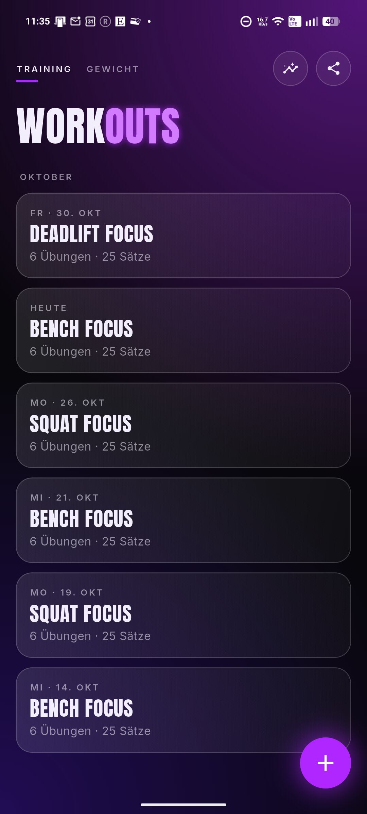
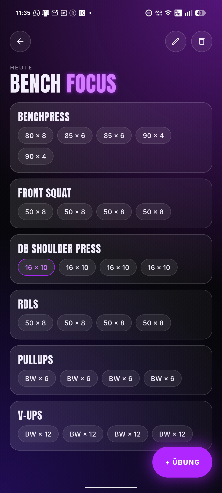
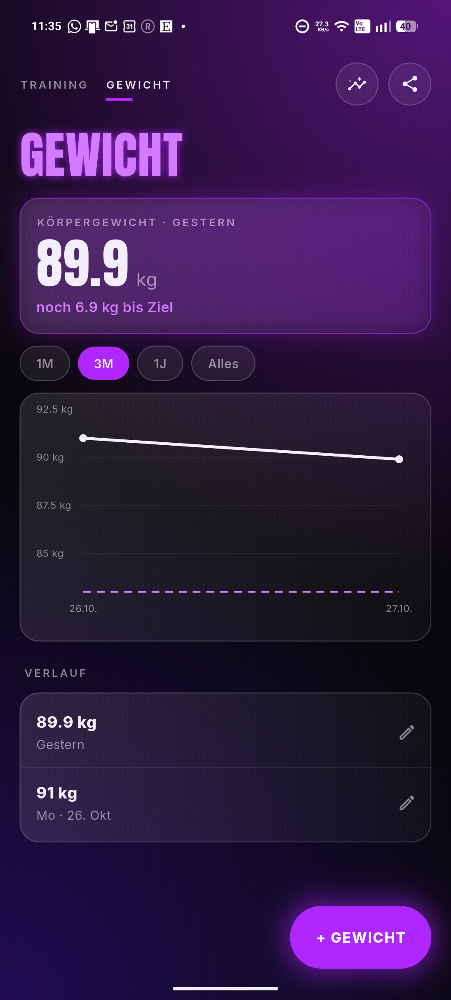
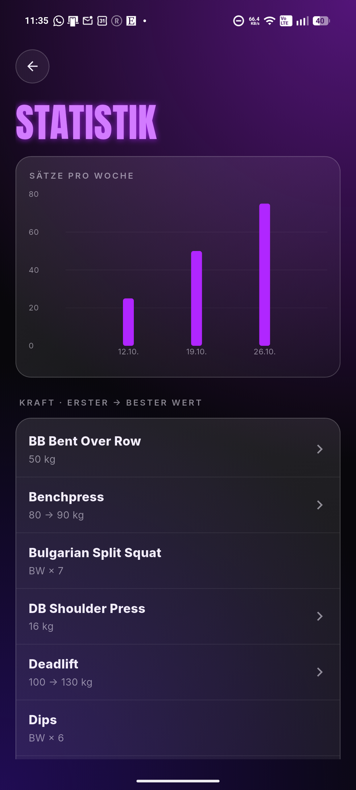

<p align="center">
  
</p>

<h1 align="center">Workout Tracker</h1>

<p align="center">
  An offline Android app to log strength training. Built in Python.
</p>

<p align="center">
  <a href="https://github.com/felix-harenberg/workout-tracker/actions/workflows/tests.yml"></a>
  <a href="https://github.com/felix-harenberg/workout-tracker/releases/latest"></a>
  
  <a href="LICENSE"></a>
</p>

<p align="center">
  
  
  
  
</p>

---

**Jump to:** [Why](#why) · [Features](#features) · [Install](#install) · [How it's built](#how-its-built) · [Run it from source](#run-it-from-source) · [What I learned](#what-i-learned)

## Why

I used to log my workouts in a text file. It worked, but I never saw what I lifted last time when it mattered: between two sets. So I built the app I actually want to use in the gym: fast to log, works offline, and my data stays on my phone.

## Features

- **Last time, right there.** Every exercise shows what you did last time, and the next set is prefilled with it. Same weight? Tap ✓ twice. A bit more? +2.5 kg.
- **Repeat a workout.** Start from a previous one ("Wie letztes Mal") and its exercises are waiting. Did the same as last time? Take over all sets with one tap.
- **Remind yourself.** Felt too easy? Tap ▲ and next time the app reminds you to go up in weight (▼ to go down).
- **Records.** Beat your heaviest set and the app notices, dryly. A suspicious jump (more than 20 %) gets a "typo?" check first.
- **Progress.** Sets per week, heaviest weight per exercise as a chart, and first → best for every exercise.
- **Bodyweight.** Swipe to a second page: weigh-ins with a dashed goal line, losing or gaining.
- **Offline, no account.** Everything lives in one SQLite file on your phone. Export to CSV anytime.

The app's interface is in German.

## Install

1. Open the [latest release](https://github.com/felix-harenberg/workout-tracker/releases/latest) on your Android phone (64-bit, Android 7 or newer).
2. Download the `.apk` file.
3. Open it and allow installing from this source when Android asks.

No Play Store, no account, no internet needed. Updates install over the old version and keep your data.

## How it's built

| | |
| --- | --- |
| Language | Python 3.12 |
| UI | [Flet](https://flet.dev) (Flutter under the hood, builds a real Android APK) |
| Storage | SQLite via the standard library, with schema migrations |
| Tests | pytest, 250+ tests |
| Lint / format | ruff |
| CI | GitHub Actions: tests on every push, APK on every push to `main`, GitHub release on every version tag |

The one rule that shapes the code: **logic and UI are strictly separated.**

```
src/
├── core/   models, database, migrations, calculations (records, volume, suggestions)
│           never imports Flet, fully covered by tests
└── ui/     Flet screens only, calls core/, no business logic
```

Because `core/` doesn't know the UI exists, almost all of the app is tested on a laptop without a phone. A walkthrough of the code (in German) is in [docs/so-funktionierts.md](docs/so-funktionierts.md).

## Run it from source

```bash
git clone https://github.com/felix-harenberg/workout-tracker.git
cd workout-tracker
python -m venv .venv
.venv\Scripts\activate          # macOS/Linux: source .venv/bin/activate
pip install -e ".[dev]"

pytest                          # run the tests
flet run src/main.py            # open the app in a desktop window
```

The APK is built by GitHub Actions, not locally (the Android toolchain is heavy). To release a version, push a tag like `v1.0.0`; the workflow builds the APK and publishes the release, with notes from `docs/releases/<tag>.md` if that file exists.

## What I learned

- **Separate logic from UI, early.** Keeping `core/` free of Flet made 250+ tests possible without a phone, and kept every bug in an obvious place.
- **Your users' data outlives your schema.** The database on my phone had real trainings in it when runs, reminders and bodyweight arrived. Versioned migrations (`PRAGMA user_version`) upgrade it in place, and a test opens an old database to prove nothing is lost.
- **Android cares about signatures and build numbers.** Without a fixed signing key, every CI build was a "different app" and updates wiped the data. And the build number has to grow across workflows, so it is the commit count, not a per-workflow run number.
- **Time zones are everywhere.** Picking 22 October saved 21 October: the date picker sends local midnight as UTC. Rounding to the nearest day fixed it without knowing the phone's time zone.
- **When something works only sometimes, read the source.** Chart labels vanished at random because the chart library only asks for labels on its own grid. Reading Flet's source in `.venv` also explained the default splash logo.
- **Test on the real device after every step.** Every feature went to my phone via CI before the next one started. Many fixes came from using the app in the gym, not from the code.
- **Cutting scope is a decision.** Hyrox, run tracking and an estimated 1RM were planned and then dropped: other apps already do them, or I simply didn't need them. The app got better by doing fewer things well.

## How it was made

I planned, designed and tested this app and decided what goes in; the code was written together with an AI pair programmer ([Claude Code](https://claude.com/claude-code)). Every change was reviewed, explained (see the walkthrough above) and tested on my phone before the next step.

## License

MIT. See [LICENSE](LICENSE).
