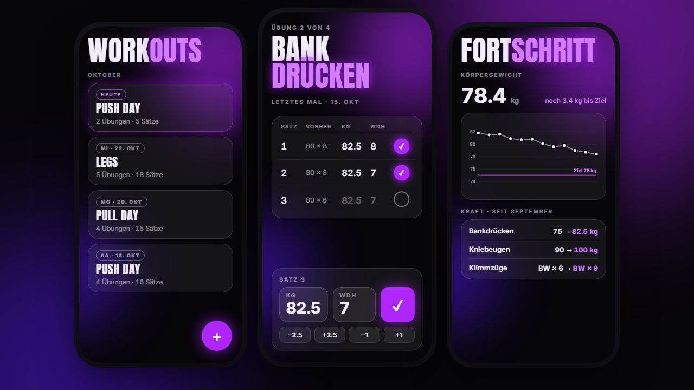

<!--
  README draft (idea branch). Not the real README yet.
  Placeholders: [APP-NAME], screenshots (hero.png shows concept mockups, replace with real app screenshots before 1.0).
-->

<p align="center">
  
</p>

<h1 align="center">[APP-NAME]</h1>

<p align="center">
  An offline Android app to log strength training. Built in Python.
</p>

<p align="center">
  <a href="https://github.com/felix-harenberg/workout-tracker/actions/workflows/tests.yml"></a>
  <a href="https://github.com/felix-harenberg/workout-tracker/releases"></a>
  
  <a href="../../../LICENSE"></a>
</p>

<p align="center">
  
</p>

---

**Jump to:** [Install the app](#install) · [Features](#features) · [How it's built](#how-its-built) · [Run it from source](#run-it-from-source) · [What I learned](#what-i-learned)

## Why

I used to log my workouts in a text file. It worked, but I never saw what I lifted last time when it mattered: between two sets. So I'm building the app I actually want to use in the gym: fast to log, works offline, and my data stays on my phone.

## Features

- **Log a set in one tap.** Every set is prefilled with what you did last time. Same weight? Tap ✓. A bit more? +2.5 kg.
- **Remind yourself.** Felt too easy? Tap ▲ and next time the app reminds you to go up in weight (▼ to go down).
- **See progress.** Strength as simple before → after numbers, bodyweight as a chart with your goal line.
- **New record?** The app notices. And asks if you mistyped first.
- **Offline, no account.** Everything lives in one SQLite file on your phone. Export to CSV anytime.

## Install

1. Open the [latest release](https://github.com/felix-harenberg/workout-tracker/releases/latest) on your Android phone.
2. Download the `.apk` file.
3. Open it and allow installing from this source when Android asks.

No Play Store, no account, no internet needed.

## How it's built

| | |
| --- | --- |
| Language | Python 3.12 |
| UI | [Flet](https://flet.dev) (Flutter under the hood, builds a real Android APK) |
| Storage | SQLite via the standard library |
| Tests | pytest |
| Lint / format | ruff |
| CI | GitHub Actions: tests on every push, APK build on every release |

The one rule that shapes the code: **logic and UI are strictly separated.**

```
src/
├── core/   models, database, calculations (records, volume)
│           never imports Flet, fully covered by tests
└── ui/     Flet screens only, calls core/, no business logic
```

Because `core/` doesn't know the UI exists, almost all of the app is tested on a laptop without a phone.

## Run it from source

```bash
git clone https://github.com/felix-harenberg/workout-tracker.git
cd workout-tracker
python -m venv .venv
.venv\Scripts\activate          # macOS/Linux: source .venv/bin/activate
pip install -e ".[dev]"

pytest                          # run the tests
flet run src/main.py            # open the app in a desktop window
```

The APK is built by GitHub Actions, not locally (the Android toolchain is heavy).

## What I learned

<!-- Fill in at 1.0. Ideas: keeping core/ free of UI made testing easy; Flet as a niche framework and the early phone test; scoping a side project to 3 hours a week. -->

## Status

In development. Built in phases, 3 hours a week. Next up: see [the plan](../../PLAN.md).

## License

MIT. See [LICENSE](../../../LICENSE).
